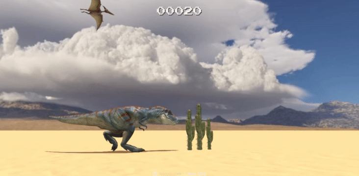

# T-Rex Game in 3D: Frozen Night

A Chrome T-Rex game remake using JavaScript and three.js, retextured with a "Frozen Night" theme: an icy T-Rex, frosted cacti, a violet pterodactyl, snowy ground and an aurora night sky.

Original game look:



## Play

Open `docs/index.html` through a local web server (for example `npx serve docs`), or turn on GitHub Pages for the `docs` folder. Press any key, click or tap to jump.

## Build the code

> Make sure you have node 12+ installed: https://nodejs.org/en/download/

- Install all dependencies by `npm i` or `yarn` if you have yarn installed.
- Run demo locally: `npm start`
- Build the whole demo into `/docs` folder: `npm run build`

## Changing the textures

`tools/make_textures.py` regenerates the theme. It creates `docs/snow.jpg` and `docs/night-sky.jpg` and recolors the model diffuse textures in place:

```
pip install numpy pillow
python3 tools/make_textures.py docs
```

Edit the color stops in the script to make a different theme. Run it on the original model textures, since it recolors whatever is there.

## Credits

**Original game:** [T-Rex Game in 3D](https://github.com/rossning92/t-rex) by Ross Ning ([@rossning92](https://github.com/rossning92)), released under the MIT license. This project is a modified version of that game.

**3D models** (all from Sketchfab, licensed under [CC BY 4.0](http://creativecommons.org/licenses/by/4.0/)):

- T-Rex: [Randaling T- Rex, animated!](https://sketchfab.com/3d-models/randaling-t-rex-animated-09a3632365344a99bb88e3dd0b684c89) by [quander](https://sketchfab.com/quander)
- Pterodactyl: [Flying Pterodactyl](https://sketchfab.com/3d-models/flying-pterodactyl-eafb9659e4d849db87d0f7e619f4d9b3) by [dudeperfecto8o](https://sketchfab.com/dudeperfecto8o)
- Cactus: [Cactus 1 (Downloadable)](https://sketchfab.com/3d-models/cactus-1-downloadable-976b67b80efd4a7388ec85bfc4e39ecf) by [rhcreations](https://sketchfab.com/rhcreations)

**Changes made to the models:** the diffuse (color) textures of all three models were recolored for the Frozen Night theme. Geometry, animations and other texture maps are unchanged.

**Font:** [Press Start 2P](https://fonts.google.com/specimen/Press+Start+2P) by CodeMan38, SIL Open Font License, via [@fontsource](https://fontsource.org/).

**Snow ground and night sky textures:** generated procedurally by `tools/make_textures.py` for this version.
